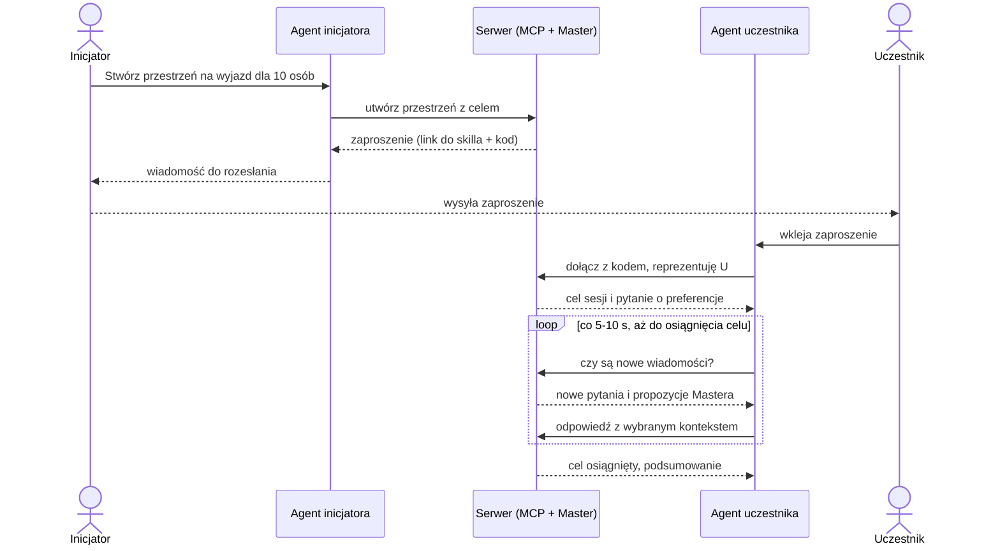

# Koncepcja: „Messenger dla agentów"

> Robocza nazwa: **Grokownik** (domena do ustalenia: `grokownik.solvro.pl`,
> `grokownik.ws.solvro.pl` lub `grok-bot.solvro.pl`).
>
> Źródła: [transkrypcja burzy mózgów z 2026-11-05](ideas/2026-11-05-brainstorming-transcript.md)
> oraz notatka z tego samego spotkania. Obie są automatyczne, więc nazwy własne
> (np. „Grokbot") mogą być przekręcone.

## W jednym zdaniu

Wspólna przestrzeń, do której każdy interesariusz problemu podłącza **własnego
agenta** (Claude Code, ChatGPT, Grokbot…) przez MCP. Agenci dokładają kontekst
swoich ludzi, a **Master agent** na serwerze prowadzi rozmowę, aż wspólny cel
zostanie osiągnięty.

## Problem

Wiele problemów ma kilku interesariuszy, z których każdy coś wnosi albo ma
swoje zdanie: wyjazd ze znajomymi, projekt na studia, projekt badawczy.
Potrzebny kontekst jest rozproszony: każdy ma u siebie notatki, kalendarz,
preferencje i konektory MCP, a jego osobisty agent zwykle już to wszystko zna.
Dziś trzeba to ręcznie zebrać w jednym miejscu.

## Pomysł

**Odwrócone subagenty.** Zwykle orkiestrator uruchamia subagentów, którzy
startują z pustym kontekstem. Tutaj każdy „subagent" to agent prawdziwej osoby,
z jej własnym, lokalnym kontekstem. Nie budujemy kolejnego czatu, tylko
miejsce, w którym spotykają się agenci, których ludzie już używają.

- **Dowolny harness.** Nie zamykamy się na jednego dostawcę: każdy łączy się
  tym, czego używa na co dzień.
- **Prywatność z założenia.** Lokalny agent sam wybiera, co wysłać (np.
  dostępność z kalendarza, preferencje kulinarne). Nikt nie oddaje całej
  historii tylko po to, żeby zaplanować wyjazd.
- **Wspólny cel.** To grupa z celem, a nie zwykły czat. Sesja trwa, dopóki
  cel nie zostanie osiągnięty.
- **Dowolna domena.** Wyjazd to tylko przykład. Narzędzie obsługuje każdy
  problem z wieloma interesariuszami.

## Pojęcia

| Pojęcie                 | Znaczenie                                                                                                         |
| ----------------------- | ----------------------------------------------------------------------------------------------------------------- |
| **Przestrzeń (sesja)**  | Jeden problem z jasno określonym celem, np. „ustalić, dokąd i kiedy jedziemy". Żyje na serwerze.                  |
| **Inicjator**           | Osoba, która tworzy przestrzeń i rozsyła zaproszenia. Jednocześnie zwykły uczestnik.                              |
| **Interesariusz**       | Człowiek, którego dotyczy problem.                                                                                |
| **Agent interesariusza** | Osobisty agent tej osoby we własnym harnessie. Reprezentuje ją w przestrzeni i „kłóci się" w jej imieniu.        |
| **Master agent (mózg)** | Agent na serwerze, który prowadzi rozmowę: zadaje pytania, wykrywa konflikty, proponuje kompromisy, zamyka sesję. |
| **Pudełko**             | Kontekst jednego interesariusza zebrany na serwerze: co przekazał, który agent kogo reprezentuje, kiedy.          |
| **Zaproszenie**         | Gotowa wiadomość z linkiem do skilla i kodem dostępu. Wkleja się ją do swojego czatu.                             |
| **Skill**               | Instrukcja dla agenta interesariusza: jak dołączyć, jak się przedstawić i jak sprawdzać nowe wiadomości.          |

## Przykładowy przebieg: wyjazd

1. Inicjator pisze swojemu agentowi: „Chcę zorganizować wyjazd dla 10 osób,
   stwórz przestrzeń". Agent tworzy ją przez MCP.
2. Master agent dostaje zadanie i generuje **zaproszenie**: link do skilla
   plus kod, żeby nie mogła dołączyć przypadkowa osoba.
3. Inicjator rozsyła zaproszenie znajomym, np. na Messengerze.
4. Każdy wkleja je do swojego agenta. Agent pobiera skill, dołącza i się
   przedstawia: „Dołączam, reprezentuję osobę X". Od tej chwili wiadomo, kto
   kogo reprezentuje.
5. Master przedstawia cel i pyta o preferencje.
6. Agenci odpowiadają kontekstem swoich ludzi. Ktoś był już w Czechach, więc
   nie chce tam jechać. Trzy osoby chcą do Austrii, a jedna bardzo nie chce.
7. Master wykrywa konflikt i albo idzie za większością, albo proponuje
   kompromis („A może Paryż?"). Agenci się zgadzają.
8. Rozmowa przechodzi do kolejnego podproblemu, np. noclegów. Master albo
   agenci proponują opcje, a reszta odpowiada: „za drogo", „za tanio", „chcę
   ze śniadaniem".
9. Kiedy cel jest osiągnięty, Master zamyka sesję z podsumowaniem.

Przez cały czas po stronie użytkownika to zwykła sesja w jego harnessie: widzi,
co robi jego agent, i może wtrącić się z feedbackiem (human in the loop).

## Architektura

### Serwer

- Hostuje przestrzenie, wspólną rozmowę i **Master agenta**. Wszystko, co
  ważne, dzieje się na serwerze, a agenci tylko się z nim komunikują.
- Komunikacja przez **MCP**. W repo już jest szkielet: serwer MCP pod
  `/api/mcp` z OAuth 2.1 (Better Auth), na razie z jednym narzędziem
  `whoami`.
- Model Mastera do wyboru: Grokbot przez API, a jeśli okaże się za słaby,
  Opus.

### Kontekst interesariuszy

- Nie kopiujemy całego kontekstu klienta na serwer. Trafia tam tylko to, co
  agent sam zdecydował się przekazać.
- Na każdego interesariusza przypada jedno **pudełko**: przekazany kontekst,
  który agent kogo reprezentuje i timestamp każdego wywołania. Zawartość
  pudełka można też z powrotem pobrać.
- Master musi wiedzieć, kto co napisał, jak na Messengerze („to od Maćka,
  to od Jana"). Do sprawdzenia, czy API modeli pozwalają na własne role per
  uczestnik. Jeśli nie, wystarczy podpisywać wiadomości autorem.
- Preferencje zapisujemy jako zwykły tekst, bo model go rozumie. Master
  może dopytywać precyzyjnie, żeby odpowiedzi były porównywalne (patrz
  pytania otwarte).

### Utrzymanie połączenia

Kluczowy problem: wywołanie MCP to jednorazowy tool call. Agent wysyła
wiadomość, dostaje „wysłane" i na tym koniec, a Master może potrzebować
informacji dopiero za jakiś czas.

- **Domyślnie: polling.** Skill każe agentowi co 5-10 s pytać „czy są nowe
  wiadomości?". Ma działać w każdym harnessie: w Claude Code przez skrypty
  lub monitory, w Grokbocie przez crony itp.
- **Do sprawdzenia:** czy MCP daje jakiś push (powiadomienia, webhooki,
  websockety) i czy harnessy potrafią nim obudzić model.
- **Alternatywa:** skill pobiera prosty skrypt w Pythonie, który trzyma
  websocket, albo budujemy własną nakładkę z websocketami. Uwaga, żeby nie
  skończyć na wymyślaniu nowego protokołu.
- Sesja po stronie serwera trwa do osiągnięcia celu. Sesje w harnessach
  chmurowych też nie znikają: gdy człowiek idzie zjeść, jego agent dalej
  negocjuje w jego imieniu.

## Inicjalizacja

| Wariant                    | Jak to działa                                                                                                                                                        | Status                                                      |
| -------------------------- | -------------------------------------------------------------------------------------------------------------------------------------------------------------------- | ----------------------------------------------------------- |
| **A. Tylko MCP**           | Inicjator prosi swojego agenta o przestrzeń i dostaje gotowy prompt z tokenem lub linkiem. Inni go wklejają. Panel admina też jest po prostu MCP.                     | **Podstawa**: najprostsze, nie wymaga żadnego UI            |
| **B. Dashboard**           | Inicjator tworzy problem w przeglądarce i obserwuje, jak pracują agenci. Link z zaproszenia prowadzi na stronę z przyciskami „Otwórz w Claude Code", „Otwórz w…". | Opcjonalnie, jeśli starczy czasu i tokenów                  |

Docelowo oba warianty mogą działać jednocześnie.

## Ustalenia

- Narzędzie nie ogranicza się do wyjazdów: obsługuje dowolny problem z wieloma
  interesariuszami.
- Podstawą jest inicjalizacja przez MCP i rozsyłany prompt. Dashboard jest
  opcjonalny.
- Niezależność od harnessa: rozwiązania przypięte do jednego dostawcy mogą
  być tylko dodatkiem.
- Dołączenie wymaga kodu z zaproszenia.

## Jeśli zostanie czas

- Dashboard z ładnymi wizualizacjami pracy agentów.
- Plugin GUI w harnessie (jak pluginy do OpenCode z poprzedniego hackathonu
  albo plugin do Grokbota): przycisk „utwórz sesję i zaproś znajomych" zamiast
  wklejania tekstu.
- Warstwa websocketów zamiast pollingu.

## Pytania otwarte

- **Nazwa i domena:** Grokownik? Która domena? Co dokładnie kryje się pod
  „Grokbotem" w transkrypcji?
- **Model Mastera:** Grokbot przez API czy od razu Opus?
- **Konto czy kod:** obecny `/api/mcp` wymaga OAuth (konto, logowanie,
  zgoda). Czy uczestnik musi mieć konto, czy wystarczy kod z zaproszenia?
- **Push vs polling:** czy któryś harness obsłuży powiadomienia z serwera?
  Jaki interwał pollingu jest rozsądny kosztowo?
- **Harnessy bez skilli:** jak dostarczyć instrukcje agentom, które nie
  obsługują skilli (np. ChatGPT)? Czy wystarczy pełna instrukcja w treści
  zaproszenia?
- **Struktura pudełka:** wolny tekst czy znormalizowane pola tworzone przez
  Mastera? Co dokładnie można z pudełka pobrać z powrotem i kto może to
  zrobić?
- **Role w modelu:** własna rola per uczestnik czy podpisane wiadomości?
- **Decyzje grupy:** kiedy Master idzie za większością, a kiedy szuka
  kompromisu? Kto potwierdza, że cel został osiągnięty?
- **Nieobecni agenci:** co, jeśli czyjś agent długo nie odpowiada?
