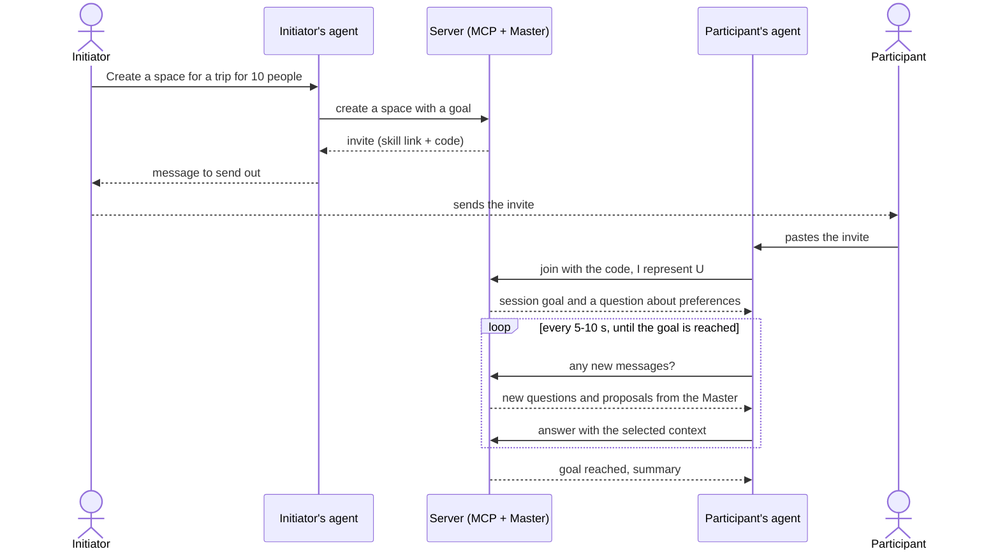

# Concept: "Messenger for agents"

> Working name: **Grokownik** (domain to be decided: `grokownik.solvro.pl`,
> `grokownik.ws.solvro.pl` or `grok-bot.solvro.pl`).
>
> Sources: [brainstorming transcript from 2026-11-05](ideas/2026-11-05-brainstorming-transcript.md)
> and a note from the same meeting. Both are automatic, so proper names
> (e.g. "Grokbot") may be garbled.

## In one sentence

A shared space where every stakeholder in a problem connects **their own
agent** (Claude Code, ChatGPT, Grokbot…) over MCP. The agents contribute their
people's context, and a **Master agent** on the server runs the conversation
until the shared goal is reached.

## Problem

Many problems have several stakeholders, each of whom contributes something or
has an opinion: a trip with friends, a university project, a research project.
The context that is needed is scattered: everyone has their own notes,
calendar, preferences and MCP connectors, and their personal agent usually
already knows all of it. Today it has to be gathered in one place by hand.

## Idea

**Reverse subagents.** Normally an orchestrator spawns subagents that start
with an empty context. Here every "subagent" is the agent of a real person,
with that person's own local context. We are not building yet another chat,
but a place where the agents people already use can meet.

- **Any harness.** We don't lock ourselves into one vendor: everyone connects
  with whatever they use every day.
- **Privacy by design.** The local agent decides what to send (e.g. calendar
  availability, food preferences). Nobody hands over their whole history just
  to plan a trip.
- **Shared goal.** It is a group with a goal, not a regular chat. The session
  lasts until the goal is reached.
- **Any domain.** A trip is only an example. The tool handles any problem with
  multiple stakeholders.

## Terms

| Term                     | Meaning                                                                                                                         |
| ------------------------ | ------------------------------------------------------------------------------------------------------------------------------- |
| **Space (session)**      | One problem with a clearly defined goal, e.g. "decide where and when we go". Lives on the server.                               |
| **Initiator**            | The person who creates the space and sends out the invites. Also a regular participant.                                         |
| **Stakeholder**          | A human affected by the problem.                                                                                                |
| **Stakeholder agent**    | That person's personal agent in their own harness. Represents them in the space and "argues" on their behalf.                  |
| **Master agent (brain)** | The agent on the server that runs the conversation: asks questions, detects conflicts, proposes compromises, closes the session. |
| **Box**                  | The context of one stakeholder collected on the server: what they shared, which agent represents whom, and when.               |
| **Invite**               | A ready-made message with a link to the skill and an access code. You paste it into your own chat.                              |
| **Skill**                | Instructions for the stakeholder agent: how to join, how to introduce itself and how to check for new messages.                 |

## Example flow: a trip

1. The initiator tells their agent: "I want to organise a trip for 10 people,
   create a space". The agent creates it over MCP.
2. The Master agent receives the task and generates an **invite**: a link to
   the skill plus a code, so that a random person can't join.
3. The initiator sends the invite to their friends, e.g. on Messenger.
4. Everyone pastes it into their agent. The agent fetches the skill, joins and
   introduces itself: "Joining, I represent person X". From then on it is
   known who represents whom.
5. The Master presents the goal and asks about preferences.
6. The agents answer with their people's context. Someone has already been to
   Czechia, so they don't want to go there. Three people want to go to
   Austria, and one really doesn't.
7. The Master detects the conflict and either goes with the majority or
   proposes a compromise ("How about Paris?"). The agents agree.
8. The conversation moves on to the next subproblem, e.g. accommodation. The
   Master or the agents propose options, and the others reply: "too
   expensive", "too cheap", "I want breakfast included".
9. When the goal is reached, the Master closes the session with a summary.

The whole time, on the user's side it is a regular session in their harness:
they can see what their agent is doing and step in with feedback (human in the
loop).

## Architecture

### Server

- Hosts the spaces, the shared conversation and the **Master agent**.
  Everything important happens on the server; the agents only talk to it.
- Communication over **MCP**. The repo already has a skeleton: an MCP server
  at `/api/mcp` with OAuth 2.1 (Better Auth), for now with a single tool,
  `whoami`.
- The Master's model is still open: Grokbot via API, or Opus if that turns
  out to be too weak.

### Stakeholder context

- We don't copy the client's whole context to the server. Only what the agent
  itself decided to share ends up there.
- Each stakeholder has one **box**: the shared context, which agent represents
  whom, and a timestamp of every call. The contents of the box can also be
  pulled back.
- The Master has to know who wrote what, like on Messenger ("this one is from
  Maciek, that one from Jan"). To check: whether model APIs allow custom
  roles per participant. If not, signing every message with its author is
  enough.
- Preferences are stored as plain text, because the model understands it. The
  Master can ask precise follow-up questions so that answers are comparable
  (see open questions).

### Keeping the connection

The key problem: an MCP call is a one-off tool call. The agent sends a
message, gets "sent" back and that's it, while the Master may need more
information only some time later.

- **Default: polling.** The skill tells the agent to ask "any new messages?"
  every 5-10 s. It has to work in every harness: in Claude Code through
  scripts or monitors, in Grokbot through crons, etc.
- **To check:** whether MCP offers any kind of push (notifications, webhooks,
  websockets) and whether harnesses can use it to wake the model up.
- **Alternative:** the skill downloads a simple Python script that holds a
  websocket, or we build our own websocket layer. Careful not to end up
  inventing a new protocol.
- The session on the server lasts until the goal is reached. Sessions in
  cloud harnesses don't disappear either: when the human goes to eat, their
  agent keeps negotiating on their behalf.

## Initialisation

| Variant           | How it works                                                                                                                                                        | Status                                         |
| ----------------- | ------------------------------------------------------------------------------------------------------------------------------------------------------------------- | ---------------------------------------------- |
| **A. MCP only**   | The initiator asks their agent for a space and gets a ready-made prompt with a token or link. The others paste it in. The admin panel is just MCP as well.          | **Baseline**: the simplest, needs no UI at all |
| **B. Dashboard**  | The initiator creates the problem in the browser and watches the agents work. The invite link leads to a page with "Open in Claude Code", "Open in…" buttons.      | Optional, if there is enough time and tokens   |

Eventually both variants can work side by side.

## Decisions

- The tool is not limited to trips: it handles any problem with multiple
  stakeholders.
- The baseline is initialisation over MCP plus a prompt that gets sent
  around. The dashboard is optional.
- Harness independence: solutions tied to a single vendor can only be
  add-ons.
- Joining requires the code from the invite.

## If time allows

- A dashboard with nice visualisations of the agents at work.
- A GUI plugin in the harness (like the OpenCode plugins from the previous
  hackathon, or a Grokbot plugin): a "create a session and invite friends"
  button instead of pasting text.
- A websocket layer instead of polling.

## Open questions

- **Name and domain:** Grokownik? Which domain? What exactly is behind
  "Grokbot" in the transcript?
- **Master model:** Grokbot via API, or Opus straight away?
- **Account or code:** the current `/api/mcp` requires OAuth (account, login,
  consent). Does a participant need an account, or is the invite code
  enough?
- **Push vs polling:** can any harness handle notifications from the server?
  What polling interval is reasonable cost-wise?
- **Harnesses without skills:** how do we deliver instructions to agents that
  don't support skills (e.g. ChatGPT)? Is a full instruction inside the
  invite enough?
- **Box structure:** free text, or normalised fields created by the Master?
  What exactly can be pulled back from a box, and who can do it?
- **Roles in the model:** a custom role per participant, or signed messages?
- **Group decisions:** when does the Master go with the majority, and when
  does it look for a compromise? Who confirms that the goal has been reached?
- **Absent agents:** what if someone's agent doesn't respond for a long time?
